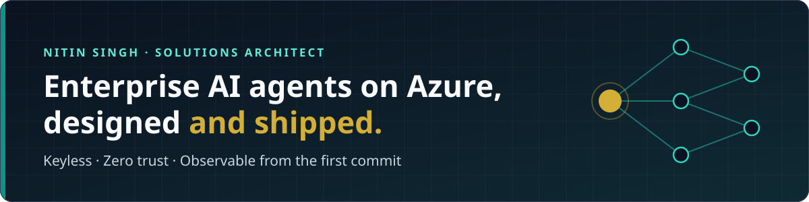
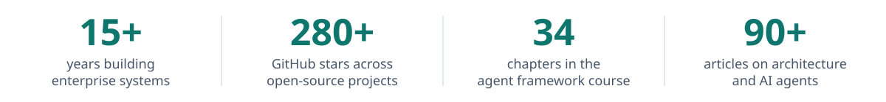
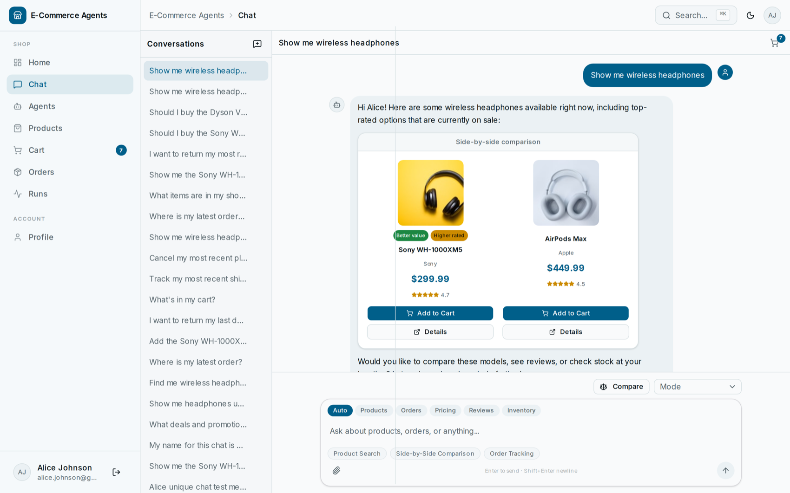
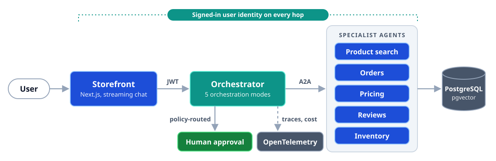

Solutions Architect with 15+ years delivering enterprise systems across insurance, fintech, and SaaS. I design the system and write the code, from API contracts through to deployment on AKS. Current focus: multi-agent and RAG systems on Azure, built keyless and zero trust from the first commit.

<picture>
  <source media="(prefers-color-scheme: dark)" srcset="assets/stats-dark.svg">
  
</picture>

## Selected work

### [e-commerce-agents](https://github.com/nitin27may/e-commerce-agents)

A complete multi-agent application, not a sample that stops at "the agent replied": a storefront, an orchestrator, and five specialist agents talking A2A, with five orchestration modes, human approvals, evals, and tracing. It ships in Python and .NET behind the same frontend, with a 34-chapter course that builds up to it. [Documentation](https://nitinksingh.com/e-commerce-agents/)

`Microsoft Agent Framework` `Python` `.NET 10` `Next.js` `PostgreSQL + pgvector` `OpenTelemetry`

The chat renders agent results as cards, tables, and charts instead of raw text. Underneath, the signed-in user's identity travels with every hop, and actions that move money wait for a human.

<picture>
  <source media="(prefers-color-scheme: dark)" srcset="assets/architecture-dark.svg">
  
</picture>

### More projects

- **[ms-graph-mcp](https://github.com/nitin27may/ms-graph-mcp)** ([docs](https://nitinksingh.com/ms-graph-mcp/)): MCP server that gives AI agents 85 Microsoft Graph tools across Outlook, Teams, OneDrive, SharePoint, OneNote, Planner, and Entra ID. Delegated OAuth, so the agent acts as the signed-in user. `Python` `MCP` `Entra ID`
- **[mcp-generator](https://github.com/nitin27may/mcp-generator)** ([docs](https://nitinksingh.com/mcp-generator/)): Governance layer that turns an OpenAPI or Swagger spec into a governed, portable MCP tool surface over stdio or Streamable HTTP. `TypeScript` `MCP`
- **[clean-architecture-docker-dotnet-angular](https://github.com/nitin27may/clean-architecture-docker-dotnet-angular)** ([docs](https://nitinksingh.com/clean-architecture-docker-dotnet-angular/)): Full-stack Clean Architecture reference with role-based access control and activity logging. 60+ stars, 30+ forks. `.NET 10` `Angular 22` `PostgreSQL` `Docker`
- **[aspire-Microservices](https://github.com/nitin27may/aspire-Microservices)**: E-commerce microservices reference orchestrated by .NET Aspire: five APIs, a Blazor UI, and messaging. `.NET Aspire` `PostgreSQL` `Redis` `RabbitMQ`
- **[mean-docker](https://github.com/nitin27may/mean-docker)** ([docs](https://nitinksingh.com/mean-docker/)): Containerized MEAN stack reference with JWT auth and a CI-verified quick start. 100+ stars, 70+ forks. `Angular 22` `Node 24` `Express 5` `MongoDB 8` `Nginx`
- **[ai-resources](https://github.com/nitin27may/ai-resources)** ([docs](https://nitinksingh.com/ai-resources/)): AI knowledge hub, from fundamentals through architecture patterns, agents, and LLM systems. `Python` `MkDocs`

Longer write-ups of each project are at [nitinksingh.com/projects](https://nitinksingh.com/projects/).

## How I work

- **Keyless by default.** Managed Identity and Workload Identity Federation instead of API keys and connection strings. Service-to-service auth carries no stored credential, and pipelines hold no secrets to leak or rotate.
- **Zero trust.** Every call is authenticated and authorized, including the ones between internal services. User identity is carried through to agents and tools with on-behalf-of flows, access is least-privilege RBAC, traffic stays on private endpoints, and tenant data is isolated.
- **Observable from day one.** OpenTelemetry traces, structured logs, and per-request token and cost tracking are part of the first deployment, not a later phase.
- **Governed AI.** Retrieval evaluation, grounding checks, content safety guardrails, and human approval on actions that matter.
- **AI-assisted, human-reviewed.** I use Claude Code and GitHub Copilot to move faster. Architectural decisions and production code still go through human review.

## Stack

| Area | Tools |
|---|---|
| AI&nbsp;and&nbsp;agents | Microsoft Agent Framework, LangGraph, Azure OpenAI, Microsoft Foundry, Azure AI Search, MCP, A2A, AG-UI, CopilotKit |
| Identity&nbsp;and&nbsp;security | Entra ID, Managed Identity, Workload Identity Federation, OBO, Key Vault, Private Endpoints, Azure Policy, Defender for Cloud |
| Cloud&nbsp;and&nbsp;delivery | Azure (AKS, Service Bus, Functions, API Management), Docker, Kubernetes, Helm, GitHub Actions, Azure DevOps |
| Backend&nbsp;and&nbsp;frontend | C# / .NET, .NET Aspire, Python, TypeScript, Angular, Next.js |
| Data&nbsp;and&nbsp;observability | Azure SQL, Cosmos DB, PostgreSQL, MongoDB, OpenTelemetry, Azure Monitor, Application Insights |

## Writing

I write about architecture, identity, and running AI agents in production at [nitinksingh.com](https://nitinksingh.com).

- [The Keyless Cookbook: Managed Identity for Every Azure Service Your Agent Touches](https://nitinksingh.com/posts/azure-keyless-managed-identity-cookbook/)
- [Zero-Secrets Architecture on Azure: Managed Identity for AI Agents](https://nitinksingh.com/posts/zero-secrets-azure-managed-identity/)
- [Choosing the Right Agent Identity: Managed Identity, Entra Agent ID, OBO, or Service Principal](https://nitinksingh.com/posts/choosing-the-right-agent-identity/)
- [The Auth Chapter Every MCP Tutorial Skips: Real SSO for Microsoft Graph](https://nitinksingh.com/posts/mcp-sso-microsoft-graph/)
- [Defense-in-Depth for AI Agents on Azure: Prompt Shields, Spotlighting, and the Coverage Gap](https://nitinksingh.com/posts/prompt-shields-spotlighting-defense-in-depth/)
- [Agree Before You Build: Five Gates for Enterprise AI Use Cases](https://nitinksingh.com/posts/five-gates-enterprise-ai-roi/)
- [Microsoft Agent Framework v1, in Python and .NET](https://nitinksingh.com/posts/maf-v1-21-putting-it-all-together/): a 28-part series

## Work with me

Most of what's here started as a problem I hit on a real project and then rebuilt in the open. If you're working on something similar, such as agent orchestration, keyless Azure, or an architecture worth thinking through, [I'm glad to talk](https://nitinksingh.com/work/).

 <a href="https://nitinksingh.com">nitinksingh.com</a> &nbsp;·&nbsp;  <a href="https://www.linkedin.com/in/nitin27may">nitin27may</a> &nbsp;·&nbsp;  <a href="https://x.com/nitin27may">@nitin27may</a> &nbsp;·&nbsp;  <a href="mailto:nitin.singh21@hotmail.com">nitin.singh21@hotmail.com</a>
