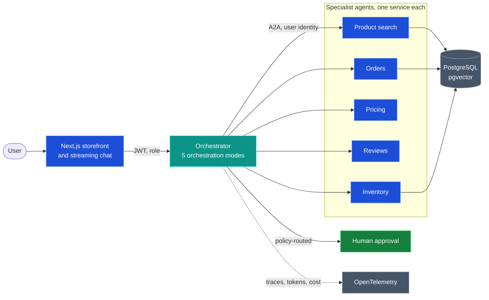

# Nitin Singh

**Architect by title, builder by choice.** Solutions Architect with 15+ years delivering enterprise systems across insurance, fintech, and SaaS. I design the system and write the code, from API contracts through to deployment on AKS. Current focus: multi-agent and RAG systems on Azure, built keyless and zero trust from the first commit.

Toronto, Canada

<a href="https://nitinksingh.com"> nitinksingh.com</a> &nbsp;·&nbsp;
<a href="https://linkedin.com/in/nitin27may"> nitin27may</a> &nbsp;·&nbsp;
<a href="https://twitter.com/nitin27may"> @nitin27may</a> &nbsp;·&nbsp;
<a href="mailto:nitin.singh21@hotmail.com"> nitin.singh21@hotmail.com</a>

## Selected work

| Project | What it is | Stack |
|---|---|---|
| [e-commerce-agents](https://github.com/nitin27may/e-commerce-agents) | A complete multi-agent application: storefront, orchestrator, and five specialist agents over A2A, with five orchestration modes, human approvals, evals, and tracing. Ships in Python and .NET, with a 34-chapter course that builds up to it. | Microsoft Agent Framework, Python, .NET 10, Next.js, PostgreSQL + pgvector |
| [ms-graph-mcp](https://github.com/nitin27may/ms-graph-mcp) | MCP server that gives AI agents 85 Microsoft Graph tools across Outlook, Teams, OneDrive, SharePoint, OneNote, Planner, and Entra ID, using delegated OAuth so the agent acts as the signed-in user. | Python, MCP, Entra ID |
| [mcp-generator](https://github.com/nitin27may/mcp-generator) | Governance layer that turns an OpenAPI or Swagger spec into a governed, portable MCP tool surface over stdio or Streamable HTTP. | TypeScript, MCP |
| [clean-architecture-docker-dotnet-angular](https://github.com/nitin27may/clean-architecture-docker-dotnet-angular) | Full-stack Clean Architecture reference with role-based access control and activity logging. 60+ stars, 30+ forks. | .NET 10, Angular 22, PostgreSQL, Docker |
| [aspire-Microservices](https://github.com/nitin27may/aspire-Microservices) | E-commerce microservices reference orchestrated by .NET Aspire: five APIs, a Blazor UI, and messaging. | .NET Aspire, PostgreSQL, Redis, RabbitMQ |
| [mean-docker](https://github.com/nitin27may/mean-docker) | Containerized MEAN stack reference with JWT auth and CI-verified quick start. 100+ stars, 70+ forks. | Angular 22, Node 24, Express 5, MongoDB 8, Nginx |

### How the agent system fits together

The topology of [e-commerce-agents](https://github.com/nitin27may/e-commerce-agents). The signed-in user's identity travels with every hop, and actions that move money wait for a human.

## How I work

- **Keyless by default.** Managed Identity and Workload Identity Federation instead of API keys and connection strings. Service-to-service auth carries no stored credential, and pipelines hold no secrets to leak or rotate.
- **Zero trust.** Every call is authenticated and authorized, including the ones between internal services. User identity is carried through to agents and tools with on-behalf-of flows, access is least-privilege RBAC, traffic stays on private endpoints, and tenant data is isolated.
- **Observable from day one.** OpenTelemetry traces, structured logs, and per-request token and cost tracking are part of the first deployment, not a later phase.
- **Governed AI.** Retrieval evaluation, grounding checks, content safety guardrails, and human approval on actions that matter.
- **AI-assisted, human-reviewed.** I use Claude Code and GitHub Copilot to move faster. Architectural decisions and production code still go through human review.

## Stack

| Area | Tools |
|---|---|
| AI and agents | Microsoft Agent Framework, LangGraph, Azure OpenAI, Microsoft Foundry, Azure AI Search, MCP, A2A, AG-UI, CopilotKit |
| Identity and security | Entra ID, Managed Identity, Workload Identity Federation, OBO, Key Vault, Private Endpoints, Azure Policy, Defender for Cloud |
| Cloud and delivery | Azure (AKS, Service Bus, Functions, API Management), Docker, Kubernetes, Helm, GitHub Actions, Azure DevOps |
| Backend and frontend | C# / .NET, .NET Aspire, Python, TypeScript, Angular, Next.js |
| Data and observability | Azure SQL, Cosmos DB, PostgreSQL, MongoDB, OpenTelemetry, Azure Monitor, Application Insights |

## Writing

I write about architecture, identity, and running AI agents in production at [nitinksingh.com](https://nitinksingh.com).

- [The Keyless Cookbook: Managed Identity for Every Azure Service Your Agent Touches](https://nitinksingh.com/posts/azure-keyless-managed-identity-cookbook/)
- [Zero-Secrets Architecture on Azure: Managed Identity for AI Agents](https://nitinksingh.com/posts/zero-secrets-azure-managed-identity/)
- [Choosing the Right Agent Identity: Managed Identity, Entra Agent ID, OBO, or Service Principal](https://nitinksingh.com/posts/choosing-the-right-agent-identity/)
- [The Auth Chapter Every MCP Tutorial Skips: Real SSO for Microsoft Graph](https://nitinksingh.com/posts/mcp-sso-microsoft-graph/)
- [Defense-in-Depth for AI Agents on Azure: Prompt Shields, Spotlighting, and the Coverage Gap](https://nitinksingh.com/posts/prompt-shields-spotlighting-defense-in-depth/)
- [Agree Before You Build: Five Gates for Enterprise AI Use Cases](https://nitinksingh.com/posts/five-gates-enterprise-ai-roi/)
- [Microsoft Agent Framework v1, in Python and .NET](https://nitinksingh.com/posts/maf-v1-21-putting-it-all-together/): a 28-part series
